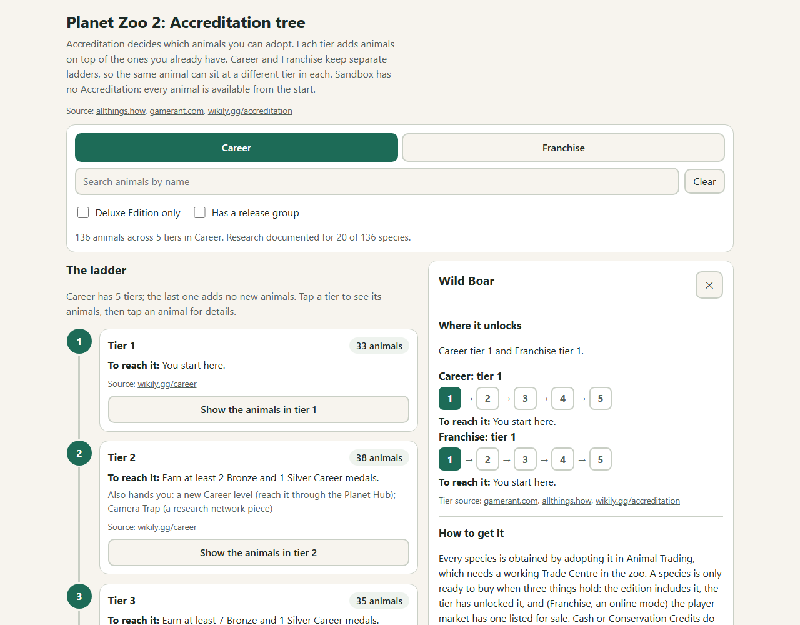
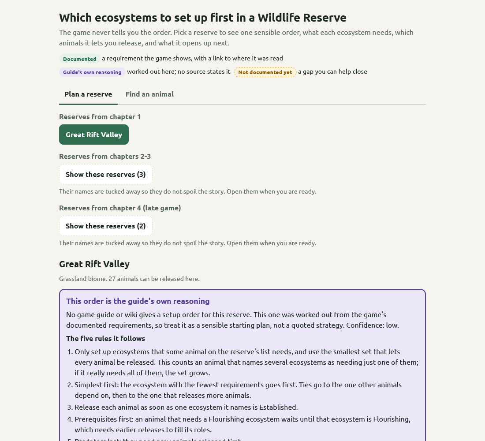

# Planet Zoo 2 — Hintforge Companion

A spoiler-controlled hint companion for **Planet Zoo 2**, Frontier's zoo and conservation sim where you build zoos, breed animals and release them into Wildlife Reserves across Career, Franchise and Sandbox. Built in the [Hintforge](https://github.com/hintforge/builder) format: a loyal sidekick that answers only from these guide files — never from guesswork — at the spoiler level you set.

## Use it

You need a Hintforge reader running in Claude Code, Codex, or OpenClaw. Point it at this repo:

> Load the Planet Zoo 2 guide from github.com/hintforge/planet-zoo-2

Then just ask — *"what tier unlocks the lion," "how do I get Silver in this level," "which ecosystem should I build first in this reserve."* Runtime setup lives in [`hintforge/reader`](https://github.com/hintforge/reader).

## A new game, honestly covered

Planet Zoo 2 came out on 13 October 2026, and the guides and wikis are still catching up. Every fact here carries its source, and most rest on one or two of them, so the guide says how sure it is rather than sounding certain. Where nobody has published something yet, the guide says *not documented yet* instead of guessing. If you have the game, you can close those gaps: screenshot the screen the gap names and give it to your Hintforge companion, and it adds what it reads.

## Spoilers

The guide volunteers nothing until you raise a dial. Planet Zoo 2 has no enemies, so the real spoiler surface is the Career: later chapters' levels, reserves and objectives stay out of answers until you raise the puzzle dial, and the two pages keep later reserves behind a button.

## What's inside

A structured Markdown corpus — core mechanics (welfare, breeding, release, conservation, economy, staff, guests), all 136 species with their Accreditation tiers in Career and Franchise, the 18 Career levels across 4 chapters with their medal objectives, the six Wildlife Reserves and their 32 ecosystems, research, controls, settings, and all 39 achievements. The companion reads and writes only the files you control.

## Accreditation tree

A self-contained page built from this corpus — [`artifacts/accreditation_tree.html`](artifacts/accreditation_tree.html). Download it, open it in any browser, keep it beside the game.

- **The ladder** — Career and Franchise tier by tier: what unlocks each tier (medal counts, zoo stars, reserve ratings) and which animals it adds.
- **Every animal** — search or filter (Deluxe only, releasable), then tap an animal for its tier in both modes, how to get it, what else gates it, and its release group.
- **Research** — each animal's research levels where they are documented. That is 20 of 136 animals so far; the rest show an empty slot that tells you which screen to screenshot to fill it.

## Reserve planner

[`artifacts/reserve_ecosystems.html`](artifacts/reserve_ecosystems.html) — which ecosystems to set up first in each Wildlife Reserve, which the game never tells you.

- **A setup order per reserve** — numbered steps, each with what the ecosystem needs to become Established and Flourishing, which animals it lets you release, and what it opens up next.
- **The order is the guide's own reasoning.** No guide or wiki publishes one yet, so this one is worked out from the game's documented requirements; the page says so on every reserve and shows the rules it used. The requirements themselves are documented facts with their sources.
- **Find an animal** — type a species to see where it can be released and what must come first.
- **Gaps you can fill** — which ecosystems each reserve offers, and the release requirements for most animals, are not published yet; each gap names the screen to screenshot.

Later reserves are hidden behind a button until you choose to see them. Rebuild either page after a corpus change with `python build.py` or `python build_ecosystems.py` in [`artifacts/`](artifacts/).
