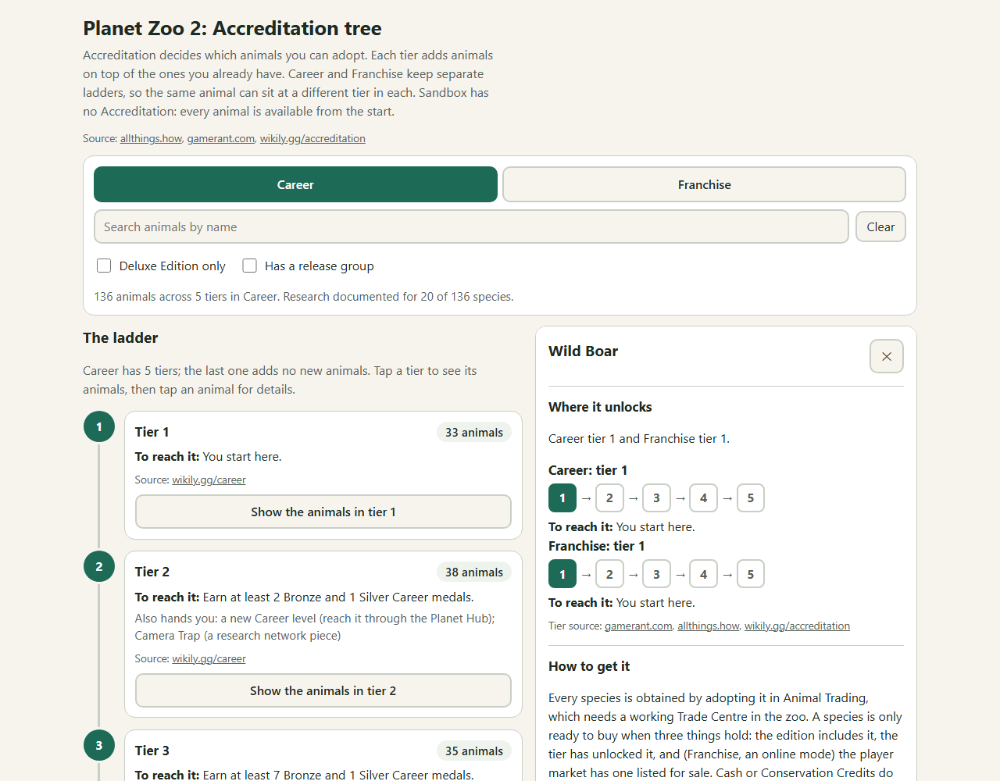
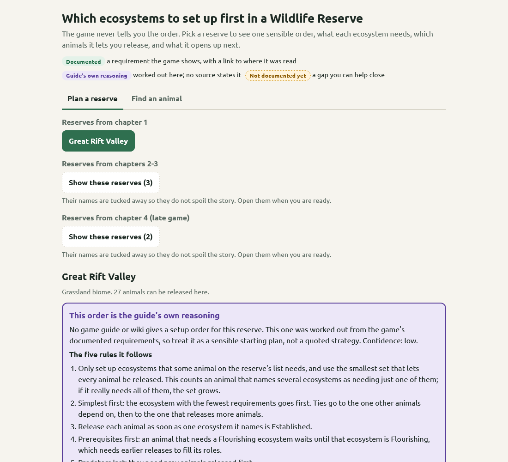

# Planet Zoo 2

A free, spoiler-controlled hint guide for Planet Zoo 2. Get help with Frontier's zoo and conservation sim across Career, Franchise and Sandbox. Your AI agent answers only from guide files.

## Use it

Install the [reader](https://github.com/hintforge/reader) in any AI agent that can read files on your computer, then tell it:

> Load the Planet Zoo 2 guide from github.com/hintforge/planet-zoo-2

The guide uses [Hintforge](https://github.com/hintforge/builder). The agent reads and writes only files you control.

## Spoilers

Nothing is volunteered until you raise a dial. There are no enemies. Later Career levels, reserves and objectives follow the puzzle dial; both tools hide later reserves behind a button.

## What's inside

- Welfare, breeding, release, conservation, economy, staff, guests, research, controls and settings.
- All 136 species and their Accreditation tiers, 18 Career levels across 4 chapters with medal objectives, six Wildlife Reserves with 32 ecosystems, and all 39 achievements.

## Coverage gaps

Released 13 October 2026, the game is still being documented. Facts cite sources, usually one or two, and confidence. Missing information says "not documented yet". Give your agent screenshots of the named screens to fill gaps.

## Accreditation tree

Open [`artifacts/accreditation_tree.html`](artifacts/accreditation_tree.html) in any browser. Browse tier requirements, animal unlocks, acquisition gates and release groups. Search and filter Deluxe or releasable animals. Research covers 20 of 136 animals; gaps request screenshots.

## Reserve planner

[`artifacts/reserve_ecosystems.html`](artifacts/reserve_ecosystems.html) suggests setup orders from sourced Established/Flourishing requirements. Orders are labelled guide reasoning, with rules shown. Search animals' release dependencies. Ecosystem availability and most release requirements remain unpublished.

Rebuild with `python build.py` or `python build_ecosystems.py` in [`artifacts/`](artifacts/).
